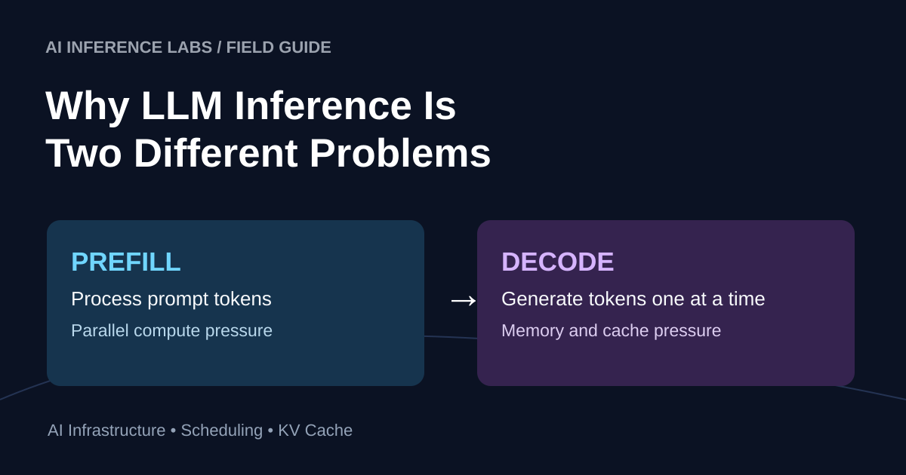
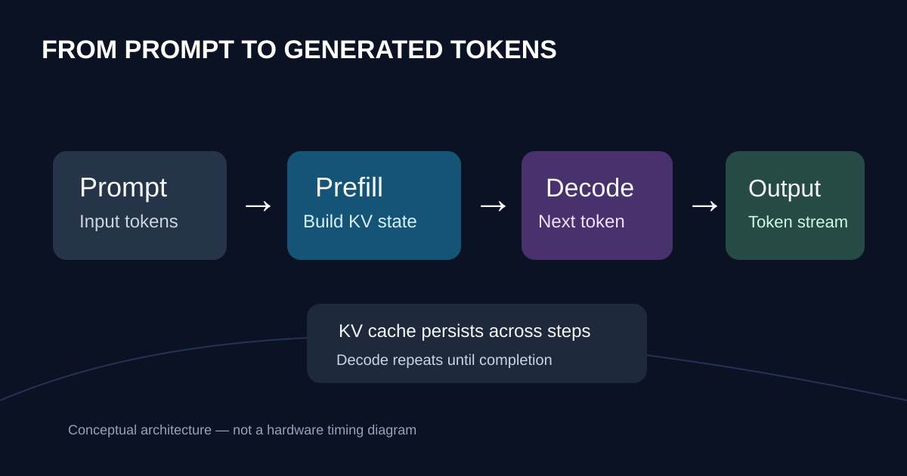
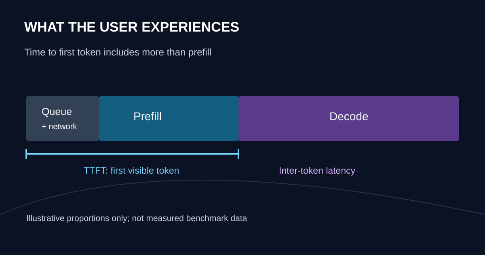

# Why LLM Inference Is Two Different Problems: Prefill and Decode

A GPU can be busy without making a user feel like their request is moving.

Picture an inference service with plenty of nominal compute capacity. Requests arrive, metrics show GPU activity, and nothing appears broken. Yet the first response token takes too long. Once it arrives, the rest of the answer trickles out.

Adding another GPU might help. It might also leave the real bottleneck untouched.

To understand why, we need to separate two jobs that often get bundled together under the label *inference*: **prefill** and **decode**.

## First, what happens to a request?

An autoregressive language model doesn't process a prompt and produce a complete answer in one operation. It reads the prompt, builds an internal representation of the context, then generates output tokens one at a time.

During **prefill**, the model processes the prompt tokens. In a transformer, this builds the attention keys and values needed for subsequent generation. Much of the prompt computation can run in parallel, though attention dependencies and implementation details still matter.

During **decode**, the model generates the next token using the current context, updates the KV cache, and repeats. Each newly generated token depends on the tokens that came before it.

The two stages may execute on the same GPU, but they place different demands on it.

| | Prefill | Decode |
| --- | --- | --- |
| Work | Process many input tokens | Produce the next output token, repeatedly |
| Parallelism | Substantial parallelism across prompt tokens | Sequential dependence between successive tokens for one request |
| Common performance pressure | Compute and prompt length | Model-weight and KV-cache memory traffic, plus batching behavior |
| User-facing symptom | Slow first token | Slow tokens after the first |
| Metric to watch | TTFT, with queue and network effects | Inter-token latency / TPOT |

These are useful tendencies, not fixed hardware laws. A very long prompt, a large batch, and different model architectures can shift the limiting resource.

## Why the first token is its own problem

Time to first token (TTFT) measures how long the client waits for the initial generated token. It is not a pure measurement of prefill compute.

A request can spend time waiting in a router, in the model server's queue, in prefill, and on the network before the client sees its first token.

That distinction matters. If TTFT rises, you need to know *which part* rose before tuning the GPU.

Consider an illustrative request—not a benchmark—with a long input and a short output. Most of its useful work could happen before the first visible token. For a chat request with a short input and a long output, decode may dominate perceived responsiveness instead.

Optimizing average end-to-end latency without separating these cases can hide the problem users notice most.

## Decode makes memory management part of scheduling

The KV cache prevents the model from recomputing prior attention keys and values at every new output step. That's essential, but it creates a memory allocation problem.

KV-cache size grows with sequence length, layer count, KV-head count, head dimension, and datatype size. For a simplified full-attention model:

`KV bytes ≈ 2 × layers × KV heads × head dimension × tokens × bytes per element`

This describes the cache tensors, not total GPU memory use. Grouped-query attention, paging, prefix sharing, quantization and implementation details change real allocation.

The influential [PagedAttention paper](https://arxiv.org/abs/2309.06180) made this operational problem concrete: serving throughput suffers when variable-length KV caches waste space through fragmentation and over-reservation. vLLM uses paged KV-cache management so capacity can be used more effectively. Those results belong to the paper's evaluated workloads; they aren't universal speedup guarantees.

Now imagine two identical backends. One has low GPU utilization but almost no room for another long-running sequence. The other reports higher utilization and has enough free cache capacity to admit a new request.

A router that only sees utilization may choose poorly.

## Prefill and decode can interfere with each other

When prefill and decode share workers, a large prompt can compete with ongoing token generation. Scheduling policies and batching reduce or amplify that interference.

The [DistServe research](https://arxiv.org/abs/2401.09670) studies separating these phases onto different GPUs, with resource allocation tuned to the time-to-first-token and time-per-output-token targets. That sounds attractive until you ask how the KV cache reaches the decode GPU. Transferring context costs bandwidth and time.

So the real question isn't simply whether prefill and decode should be separated. It's whether the gains from specialization exceed transfer and orchestration costs for your workload.

A paper can show improvement on its testbed while your deployment sees the opposite result. Network topology, model size, concurrency, prompt distribution and service-level objectives all matter.

## What this changes for infrastructure engineers

Three decisions get more interesting once you separate the phases.

**Routing.** A generic least-connections or round-robin policy doesn't know whether a destination can admit a request with a large context. A more informed router might consider queued work, expected prompt size, decode load, cache capacity and data locality.

**Capacity planning.** Counting GPUs is not enough. The mix of prompt-heavy and output-heavy requests affects achievable goodput—the number of requests completed while meeting latency objectives.

**Observability.** Request latency should be broken down into queue time, TTFT, inter-token latency, token counts and errors. The service needs to expose backend-level memory pressure and cache behavior, too.

These aren't reasons to build a complicated scheduler on day one. They're reasons to measure the right things before adding complexity.

## A useful experiment

Start with two mock inference backends. Give each a different simulated queue delay and token interval. Route traffic round-robin, record TTFT and inter-token gaps, then compare that with a simple load-aware policy.

The simulation won't prove how an actual GPU would behave. It will show what the router can and cannot infer from the signals you expose.

That's the idea behind the companion [Go streaming gateway tutorial](02-streaming-gateway.md). We start with forwarding a streamed response correctly. Later labs add queueing, telemetry and smarter routing.

## Final thought

Prefill and decode belong to the same request, but they aren't the same workload.

Treating them as separate engineering concerns changes what you measure, how you schedule, and where you spend infrastructure money. The useful next step isn't a new routing algorithm. It's making the two phases visible.

### Sources and further reading

- Kwon et al., *Efficient Memory Management for Large Language Model Serving with PagedAttention*, SOSP 2023: https://arxiv.org/abs/2309.06180
- Zhong et al., *DistServe: Disaggregating Prefill and Decoding for Goodput-optimized Large Language Model Serving*, 2024: https://arxiv.org/abs/2401.09670
- NVIDIA, *LLM Inference Benchmarking: Fundamental Concepts*: https://developer.nvidia.com/blog/llm-inference-benchmarking-fundamental-concepts/
- NVIDIA, *NIM Benchmarking Metrics*: https://docs.nvidia.com/nim/benchmarking/llm/metrics
- Companion lab: [Streaming gateway in Go](02-streaming-gateway.md)
