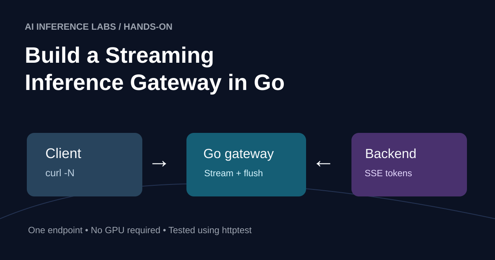

# Building a Streaming AI Inference Gateway in Go

Most people have watched a chatbot answer appear a few words at a time. It's easy to overlook the infrastructure behind that experience.

The model might need several seconds to generate a complete response. If an HTTP gateway waits for all of it before replying, users stare at a blank screen. Streaming lets clients show the beginning while the backend keeps working.

In this tutorial, we'll build a small streaming gateway in Go, start a mock inference backend, and watch the events arrive with `curl`. Then we'll follow the code from the server entry point down to the response-copy loop.

We won't need Kubernetes, a GPU, or a cloud account.

**Code:** [AI Inference Labs](../README.md) · **Prerequisites:** Go 1.22+, curl, three terminals · **Cost:** $0 locally

## Why stream inference responses?

In autoregressive inference, a model typically emits output tokens incrementally. Waiting for a whole answer discards that incremental progress at the API boundary.

There are two separate latency questions:

- **Time to first token (TTFT):** when does the client see the first generated output?
- **Time per output token (TPOT):** how quickly does the remaining output arrive?

A gateway can't make a slow model decode faster. But it can make the experience worse by buffering a response that was already ready to send.

Streaming is useful for interactive chat, code completion, and long generations. Non-streaming responses still make sense for batch processing or callers that need the final complete object.

## What are Server-Sent Events?

**Server-Sent Events (SSE)** are a standardized way to send a series of text events from a server to a client over an HTTP response. The response declares `Content-Type: text/event-stream`. Each event uses simple lines such as `data:`, optionally `event:` and `id:`, with an empty line separating events.

For example:

~~~text
data: {"token":"Hello"}

data: {"token":" world"}

data: [DONE]

~~~

The `[DONE]` marker is a convention used by some inference APIs, **not** a requirement of the SSE standard. Our mock uses it to indicate completion.

SSE is *one-directional*: the client sends an HTTP request, then the server sends updates on the response stream. WebSockets provide a two-way channel and can be better when both sides must continuously exchange messages. For ordinary text generation, a normal HTTP request plus an incremental response is often enough.

SSE is a web standard, and it's also a widely adopted format for **streaming text inference APIs**. OpenAI's streaming Chat Completions and Responses APIs use SSE, though their event schemas differ; other inference servers and gateways support OpenAI-style streaming. That doesn't mean every inference transport uses SSE, or that our synthetic event schema is OpenAI compatible.

One detail matters for browsers: the native `EventSource` interface commonly opens a GET stream. Our lab uses a POST request containing JSON and reads its SSE response through curl. A browser application making this POST would normally use `fetch()` plus a stream parser rather than `new EventSource()`.

See the [MDN guide to SSE](https://developer.mozilla.org/en-US/docs/Web/API/Server-sent_events/Using_server-sent_events) and [OpenAI's streaming guide](https://developers.openai.com/api/docs/guides/streaming-responses).

## What we'll build

Two small Go programs:

1. **Mock backend:** waits a quarter-second, sends one SSE event, then repeats. It simulates the *network shape* of token streaming, not model computation.
2. **Gateway:** forwards `POST /v1/chat/completions` to that backend and copies the response as it arrives.

The important part isn't the sample text. It's preserving the stream across an HTTP proxy.

Our endpoint borrows a common inference API path, but the mock payload is deliberately **not OpenAI-compatible JSON**. We're learning the transport first.

## Build the programs

Start by cloning the repository. If you're following the still-unmerged draft pull request, check out the tutorial branch before building:

~~~bash
git clone https://github.com/afoley587/ai-inference-labs.git
cd ai-inference-labs
git checkout content/01-prefill-decode-and-gateway

go build -o ./bin/mock-backend ./cmd/mock-backend
go build -o ./bin/gateway ./cmd/gateway
~~~

Those commands produce two local executables. There's no external Go dependency or model download.

### Terminal 1: start the simulated backend

~~~bash
./bin/mock-backend
~~~

By default, it listens on `localhost:8081` (the bind address is `:8081`).

### Terminal 2: start the gateway

~~~bash
BACKEND_URL=http://localhost:8081 ./bin/gateway
~~~

The gateway listens on port 8080 and forwards the chat-completion path to 8081.

### Terminal 3: watch the response

~~~bash
curl -N -i http://localhost:8080/v1/chat/completions \
  -H 'Content-Type: application/json' \
  -H 'Accept: text/event-stream' \
  -d '{"prompt":"Hello, infrastructure"}'
~~~

The `-i` option includes response headers. The `-N` option disables curl's output buffering, so you can see each event promptly.

You should see headers including `Content-Type: text/event-stream`, followed by events with visible pauses between them:

~~~text
data: {"token":"Hello"}

data: {"token":" from"}

data: {"token":" the"}

data: {"token":" mock"}

data: {"token":" backend"}

data: [DONE]

~~~

The exact JSON field layout is just our mock protocol. It isn't a real LLM answer.

Try hitting the backend directly:

~~~bash
curl -N http://localhost:8081/v1/chat/completions \
  -H 'Content-Type: application/json' \
  -d '{}'
~~~

Compare that with the gateway request. Both should stream rather than wait for all five tokens. This is an observation to make locally, not a published performance benchmark.

You can also ask curl to show basic timing:

~~~bash
curl -sS -N -o /dev/null \
  -w 'First response byte: %{time_starttransfer}s\nTotal: %{time_total}s\n' \
  http://localhost:8080/v1/chat/completions \
  -H 'Content-Type: application/json' \
  -d '{}'
~~~

`time_starttransfer` measures the first HTTP response byte, **not necessarily the first SSE data event**. Our proxy writes headers before it reads the first token, so don't present that curl number as model TTFT.

## Walk through the code, from top to bottom

The repository separates the executable entry point from the HTTP handler. We'll follow the same order a request takes.

### 1. Start the gateway: `cmd/gateway/main.go`

Our executable reads its backend address from an environment variable, constructs a handler, and starts an HTTP server.

~~~go
func main() {
    target := os.Getenv("BACKEND_URL")
    if target == "" { target = "http://localhost:8081" }

    handler, err := gateway.New(target)
    if err != nil { log.Fatal(err) }

    addr := os.Getenv("GATEWAY_ADDR")
    if addr == "" { addr = ":8080" }

    server := &http.Server{
        Addr: addr,
        Handler: handler,
        ReadHeaderTimeout: 5 * time.Second,
    }
    log.Printf("gateway listening on %s; upstream %s", addr, target)
    log.Fatal(server.ListenAndServe())
}
~~~

`main` does very little deliberately. It handles configuration and bootstrapping; request handling lives in `internal/gateway`.

Notice the `ReadHeaderTimeout`. It protects against clients that trickle request headers. We don't set a blanket server `WriteTimeout` in this lab because streams may stay open for longer than a normal response. Production deployments need explicit policies for maximum stream duration and idle clients.

### 2. Build the upstream client: `gateway.New()`

Before accepting requests, we validate the backend origin. We restrict it to HTTP or HTTPS, with no embedded credentials, query string, or custom path.

~~~go
func New(rawURL string) (*Handler, error) {
    u, err := url.Parse(rawURL)
    if err != nil || u == nil ||
        (u.Scheme != "http" && u.Scheme != "https") ||
        u.Host == "" || u.User != nil ||
        u.RawQuery != "" || u.Fragment != "" {
        return nil, fmt.Errorf("invalid backend URL: use an http(s) origin without credentials, query or fragment")
    }
    if u.Path != "" && u.Path != "/" {
        return nil, fmt.Errorf("backend URL must not include a path")
    }

    transport := http.DefaultTransport.(*http.Transport).Clone()
    transport.ResponseHeaderTimeout = 10 * time.Second

    return &Handler{
        target: u,
        client: &http.Client{Transport: transport},
    }, nil
}
~~~

The transport's `ResponseHeaderTimeout` limits how long we wait for upstream **headers**. It does not cap the duration of an active token stream. A fixed backend origin also avoids making this gateway a general-purpose proxy to arbitrary addresses.

### 3. Accept a request: `ServeHTTP()`

This is the main handler. It serves a health endpoint, rejects unknown paths, and accepts POST requests on a single inference path.

~~~go
func (h *Handler) ServeHTTP(w http.ResponseWriter, r *http.Request) {
    if r.URL.Path == "/healthz" && r.Method == http.MethodGet {
        w.Header().Set("Content-Type", "text/plain; charset=utf-8")
        _, _ = io.WriteString(w, "ok\n")
        return
    }
    if r.URL.Path != "/v1/chat/completions" {
        http.NotFound(w, r)
        return
    }
    if r.Method != http.MethodPost {
        w.Header().Set("Allow", "POST")
        http.Error(w, "method not allowed", http.StatusMethodNotAllowed)
        return
    }

    // The upstream request is built next...
}
~~~

Why keep the route fixed? It gives us a small, auditable surface. Later labs can introduce model-aware routing without confusing the exercise with open-proxy behavior.

Check the health endpoint:

~~~bash
curl -i http://localhost:8080/healthz
~~~

You should get `200 OK` and `ok`.

### 4. Forward the request upstream

Now we build a new HTTP request targeting the mock backend. Crucially, we carry the inbound context into it.

~~~go
target := *h.target
target.Path = r.URL.Path
target.RawQuery = r.URL.RawQuery

upstream, err := http.NewRequestWithContext(
    r.Context(), http.MethodPost, target.String(), r.Body,
)
if err != nil {
    http.Error(w, "failed to construct upstream request", http.StatusBadRequest)
    return
}
for _, name := range []string{"Content-Type", "Authorization", "Accept"} {
    if value := r.Header.Get(name); value != "" {
        upstream.Header.Set(name, value)
    }
}
~~~

Using `r.Context()` helps the upstream work stop when the downstream request is canceled. This matters for inference: a disconnected user shouldn't consume expensive decode time indefinitely.

We're forwarding selected headers for the lab. In production, authentication and header policy need more careful design. Here, there is no request-body limit and no validation of the JSON schema.

### 5. Connect to the backend

The gateway's HTTP client sends the request and waits for upstream response headers.

~~~go
resp, err := h.client.Do(upstream)
if err != nil {
    http.Error(w, "upstream unavailable", http.StatusBadGateway)
    return
}
defer resp.Body.Close()
~~~

If the connection fails before streaming starts, a normal HTTP error works. Once the first response bytes have been sent, failure reporting gets more complicated. We'll return to that.

### 6. Send headers and flush as bytes arrive

This is the heart of the tutorial.

~~~go
for _, name := range []string{"Content-Type", "Cache-Control", "X-Request-Id"} {
    if value := resp.Header.Get(name); value != "" {
        w.Header().Set(name, value)
    }
}
w.Header().Set("X-Content-Type-Options", "nosniff")
if strings.Contains(resp.Header.Get("Content-Type"), "text/event-stream") {
    w.Header().Set("Cache-Control", "no-cache")
    w.Header().Set("X-Accel-Buffering", "no")
}
w.WriteHeader(resp.StatusCode)

flusher, canFlush := w.(http.Flusher)
buf := make([]byte, 4096)
for {
    n, readErr := resp.Body.Read(buf)
    if n > 0 {
        if _, err := w.Write(buf[:n]); err != nil {
            return
        }
        if canFlush {
            flusher.Flush()
        }
    }
    if readErr != nil {
        return
    }
}
~~~

A regular `io.ReadAll(resp.Body)` would wait for the upstream response to finish. Instead, we read a chunk, write it downstream, and call `Flush` to encourage the HTTP server to send buffered bytes.

`Flush` doesn't guarantee that every token becomes a separate packet or arrives immediately. Reverse proxies, compression, network congestion, and clients can all affect delivery. The `X-Accel-Buffering: no` header is a hint understood by some proxies, not a universal HTTP feature.

Also, HTTP read boundaries do **not** correspond to SSE event boundaries. One read may contain half an event or several. That's acceptable for our byte-forwarding gateway; it doesn't inspect or transform events.

### 7. Generate the events: `cmd/mock-backend/main.go`

Finally, let's look at what the upstream server actually does.

Its handler sets SSE response headers, waits briefly, writes synthetic token events, and flushes each one.

~~~go
w.Header().Set("Content-Type", "text/event-stream")
w.Header().Set("Cache-Control", "no-cache")
w.Header().Set("X-Accel-Buffering", "no")
f, ok := w.(http.Flusher)
if !ok {
    http.Error(w, "streaming unsupported", http.StatusInternalServerError)
    return
}

for _, token := range []string{"Hello", " from", " the", " mock", " backend"} {
    select {
    case <-r.Context().Done():
        return
    case <-time.After(250 * time.Millisecond):
    }
    data, _ := json.Marshal(map[string]string{"token": token})
    if _, err := fmt.Fprintf(w, "data: %s\n\n", data); err != nil {
        return
    }
    f.Flush()
}
_, _ = fmt.Fprint(w, "data: [DONE]\n\n")
f.Flush()
~~~

This is the whole trick: the backend doesn't accumulate all the events before returning. It sends the first, pauses, sends the second, and continues.

The mock listens on `:8081` by default. You can set `MOCK_ADDR` to change the bind address.

## Experiment: what happens when the backend is unavailable?

Stop the mock backend with Ctrl+C, leave the gateway running, and make another request:

~~~bash
curl -i http://localhost:8080/v1/chat/completions \
  -H 'Content-Type: application/json' \
  -d '{}'
~~~

Expect `502 Bad Gateway`, because the gateway can't establish the upstream response.

There's a second, subtler case: suppose a backend sends three events and then disconnects. The client may already have seen `200 OK`. The gateway can't retroactively turn that into a 502. The application protocol must let the caller detect an incomplete stream. Our simple byte proxy doesn't synthesize a termination error event. This is one of the reasons production gateways handle stream lifecycles more explicitly.

Try pressing Ctrl+C while curl is still receiving events. The request context is canceled and the upstream should stop doing work. In a real serving system, cancellation may also require coordination with the inference engine.

## Where this lab fits among existing products

We're not trying to replace a production serving stack with 100 lines of Go. It's more useful to understand where the gateway sits and which responsibilities others have already solved.

| Project | Main role | Where it overlaps with our lab |
| --- | --- | --- |
| [vLLM](https://docs.vllm.ai/en/stable/serving/online_serving/openai_compatible_server/) | Model-serving engine with OpenAI-compatible HTTP endpoints | It can be the **backend** our gateway eventually forwards to; it also exposes streaming responses |
| [LiteLLM Proxy](https://docs.litellm.ai/docs/) | Unified API gateway across model providers and deployments | Routing, fallbacks, credentials, observability and proxying, far beyond our fixed-backend example |
| [Kong AI Gateway](https://developer.konghq.com/ai-gateway/streaming/) | API gateway with AI-specific policies and streaming support | A production alternative for proxying and governing inference traffic |
| [Envoy AI Gateway](https://aigateway.envoyproxy.io/) | AI-aware gateway built around Envoy | Provider integration, traffic controls and request handling at the gateway layer |
| [NVIDIA Dynamo](https://docs.nvidia.com/dynamo/latest/) | Distributed inference serving and routing infrastructure | More advanced scheduling and serving concerns we'll explore in later labs |

These aren't all direct competitors. vLLM and Dynamo include model-serving infrastructure, while LiteLLM, Kong and Envoy AI Gateway focus more on the traffic and API layer. Your deployment may use an API gateway **in front of** an inference engine rather than choosing just one.

So why build a small gateway at all? Because a working stream proxy provides a clear place to experiment with policies—routing, timeouts, backpressure, observability and cache awareness—without hiding those decisions behind a large platform.

## What we'd change before using this in production

The gateway proves one narrow concept: incrementally forward an upstream SSE response. It does **not** implement authentication, full OpenAI response schemas, body limits, multi-backend discovery or safe retry policies.

We'd add bounded concurrency, body-size limits, trusted upstream configuration, structured logs, tracing, useful latency metrics and a defined shutdown policy. We'd also need to handle failures inside a partially completed stream and confirm that any intermediate load balancer actually preserves streaming.

Streaming doesn't remove model latency. It prevents our proxy from needlessly adding a full-response wait.

## Where we go next

Our gateway only has one backend. Next we'll put several simulated backends behind it, then ask the question that matters for AI infrastructure: if they all look healthy, which one should get the next request?

That takes us from **stream forwarding** to **load-aware inference routing**.

**Repository:** [AI Inference Labs](../README.md) · [Gateway source](../internal/gateway/gateway.go) · [Mock backend](../cmd/mock-backend/main.go)

### References

- [MDN: Using Server-Sent Events](https://developer.mozilla.org/en-US/docs/Web/API/Server-sent_events/Using_server-sent_events)
- [MDN: EventSource and one-way connections](https://developer.mozilla.org/en-US/docs/Web/API/EventSource)
- [OpenAI: Streaming API Responses](https://developers.openai.com/api/docs/guides/streaming-responses)
- [Kong: AI Gateway Streaming](https://developer.konghq.com/ai-gateway/streaming/)
- [vLLM: OpenAI-Compatible Server](https://docs.vllm.ai/en/stable/serving/online_serving/openai_compatible_server/)
