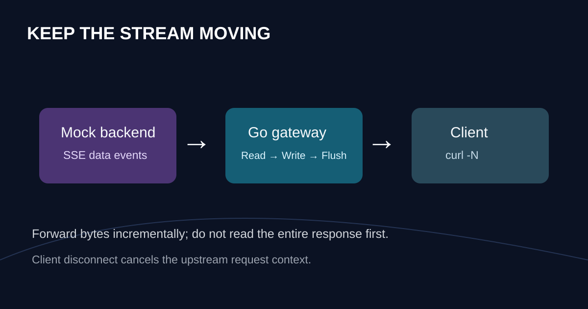

# Building a Streaming AI Inference Gateway in Go

Streaming is easy to demo and surprisingly easy to break.

An inference backend sends tokens as they become available. A proxy sits in front of it. If that proxy reads the entire upstream body before replying, your client gets an answer—but none of the responsiveness streaming was meant to provide.

Let's build a small gateway that forwards upstream Server-Sent Events (SSE) as bytes arrive.

**Source:** [AI Inference Labs](../README.md) | **Language:** Go | **Cost:** No cloud account or GPU required



## What we're building

The lab has two binaries:

- `mock-backend`: emits a few synthetic SSE tokens with a configurable delay.
- `gateway`: forwards POST requests to that backend and flushes streamed chunks toward the client.

The backend is deliberately a **simulator, not an LLM**. It lets us test network behavior without confusing that with actual prefill or decode performance.

The gateway has a single route, `POST /v1/chat/completions`, plus `GET /healthz`.

This isn't an OpenAI-compatible inference implementation. We forward request bytes and return upstream response bytes without validating the model or request format.

## Step 1: Clone and run

You need Go 1.22 or later.

```bash
git clone https://github.com/afoley587/ai-inference-labs.git
cd ai-inference-labs
go test ./...
go run ./cmd/mock-backend
```

In another terminal:

```bash
BACKEND_URL=http://localhost:8081 go run ./cmd/gateway
```

Then send a request:

```bash
curl -N -i http://localhost:8080/v1/chat/completions \
  -H 'Content-Type: application/json' \
  -d '{"prompt":"Hello, infrastructure"}'
```

Expected **shape** of the body (events arrive over time; exact timing depends on your machine):

```text
data: {"token":"Hello"}

data: {"token":" from"}

data: {"token":" the"}

data: {"token":" mock"}

data: {"token":" backend"}

data: [DONE]
```

Using `curl -N` disables curl's output buffering. It doesn't change what the server sends.

## Step 2: Forward the request without rewriting it

The gateway builds an upstream request with the incoming request context:

```go
upstreamReq, err := http.NewRequestWithContext(
    r.Context(), r.Method, target.String(), r.Body,
)
```

The context matters. When the downstream client disconnects, the upstream request can be canceled rather than continuing to generate output nobody will read.

We preserve the content type and authorization header for this limited demo. A production gateway needs a defined header policy, authentication, and protection against oversized bodies.

## Step 3: Flush chunks as they arrive

The crucial operation is not `io.ReadAll`. It's a loop that copies incoming bytes to the response and calls `Flush`.

```go
buf := make([]byte, 4096)
for {
    n, err := resp.Body.Read(buf)
    if n > 0 {
        if _, writeErr := w.Write(buf[:n]); writeErr != nil {
            return
        }
        flusher.Flush()
    }
    if err != nil {
        return
    }
}
```

An HTTP read doesn't necessarily match an SSE event boundary. That's fine here because we're forwarding a byte stream, not parsing events. A caller that needs event-level semantics must parse SSE framing separately.

The gateway copies the response status and selected headers before writing the body. Once the response has started, it cannot change the HTTP status if the upstream dies halfway through. That's a normal streaming tradeoff.

## Step 4: Verify streaming and cancellation

Run:

```bash
go test ./...
go test -race ./...
```

The test suite uses `httptest` to confirm that the client can see the first event **before** the upstream produces the next event. Another test checks error status forwarding.

Those tests don't measure GPU performance or prove low latency in a production network. They establish that the gateway doesn't intentionally buffer the entire response.

## Step 5: Explore a failure

Stop the mock backend and repeat the request. The gateway should respond with `502 Bad Gateway` before starting the stream.

Now imagine a backend that disconnects after three tokens. The client has already received a `200 OK` and some bytes. A server can't revise that status to 502 afterward. A real inference protocol needs an explicit way to represent midstream failures and a client that knows what to do with incomplete output.

## What we'd change before production

This is deliberately small. A deployable gateway would need:

- Request-body size limits and strict path handling.
- Authentication, authorization and safe header forwarding.
- Transport and connection limits, bounded concurrency, admission control and rate limits.
- Separate metrics for upstream connection, first byte and stream completion.
- OpenTelemetry traces and useful error classification.
- SSE-aware handling if the gateway wants to transform events.
- Proper load balancing, backend health and retry policies; never retry a partially delivered response as if nothing happened.
- Security controls on the upstream URL, plus TLS and deployment policies.

The code also uses a fixed backend. We're not choosing between models or GPU nodes yet.

## Where this goes next

The next lab adds multiple mock backends and selects among them. We'll begin with a naive routing policy, then expose backend load and see what changes.

But streaming comes first. If a gateway can't forward a response promptly and cancel work when the client leaves, a smarter scheduler won't fix the user experience.

**Code:** [Gateway](../cmd/gateway/main.go) · [Mock backend](../cmd/mock-backend/main.go) · [Tests](../internal/gateway/gateway_test.go)
