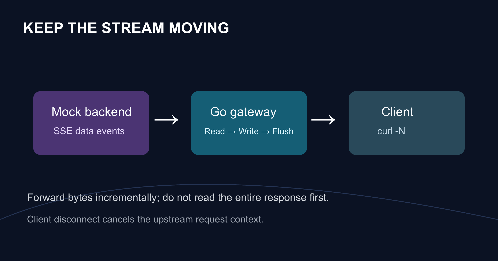
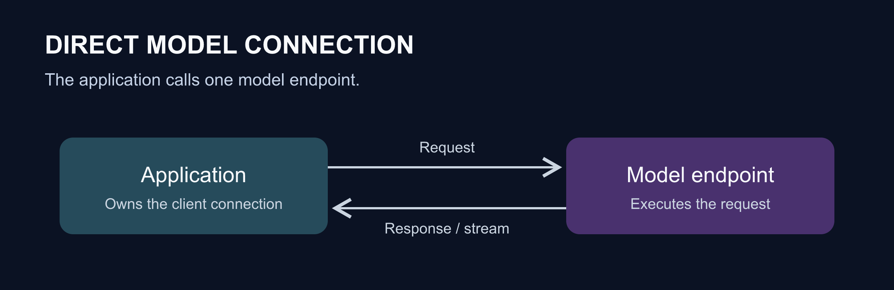
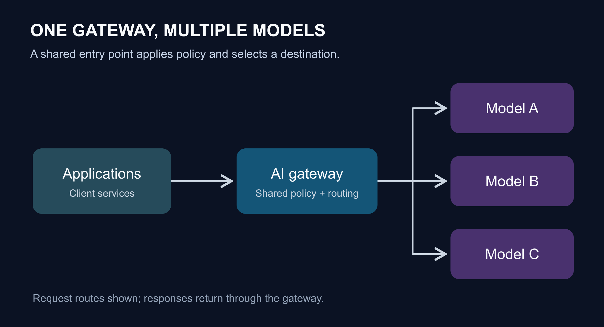
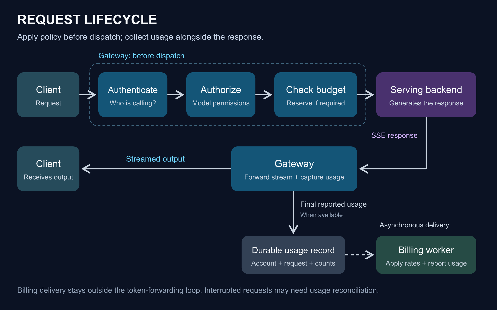

# Building a Streaming AI Inference Gateway in Go

Calling a model endpoint directly is often the best starting point for a prototype. With one model and a small application, there's little reason to add another service.

As more applications share models, a common entry point becomes useful. You may need to switch between inference providers and GPU clusters, or apply access policies in one place. An AI gateway can also track token consumption and protect backends from excess demand while handling failures.

We'll build a small part of that architecture in this lab: an HTTP gateway that forwards streamed responses as they arrive. We'll use Go and a mock inference backend, so you can see the network behavior without a GPU.

**Code:** [Streaming gateway lab](../02-streaming-gateway/) · **Prerequisites:** Go 1.22+, curl, three terminals · **Cost:** $0 locally

## 1. Where an AI gateway fits

An **AI gateway** is an application-facing entry point for model requests. It receives an inference request and applies configured policies before choosing a destination. It then forwards the request and returns the backend response to the application. Depending on the deployment, it may be a managed service or software your platform team operates.

A conventional reverse proxy already knows how to forward HTTP. An AI gateway adds decisions based on model requests, such as which model providers a team may use or how much token budget remains. Some gateways translate provider-specific APIs. Others pass requests through with policies around them. Those capabilities vary by product.

The gateway usually delegates model execution to an inference server. That server loads model weights and schedules work on GPUs. An application-facing gateway can route to a cluster or provider, while a router closer to the inference workers may use queue depth and KV-cache state to choose a specific replica. An AI gateway does not automatically have access to those worker-level signals.

We can connect an application directly or put a gateway between it and the model:

**Direct connection**

**Gateway connection**

A direct connection saves a network hop and leaves you with one less component to operate. We'd keep that design for a private model with trusted clients unless there's a need for shared policies.

A gateway starts to pay for itself when the requirements grow:

- **Routing and failover:** move requests between local GPUs and hosted providers, or across regions, without rewriting every client.
- **Credentials and access:** avoid distributing model-provider keys across services; apply per-team or per-application permissions.
- **Capacity protection:** use concurrency limits and token budgets to control demand. Admission control can reject work before it reaches an overloaded model server.
- **Observability and cost:** track latency and errors at a shared boundary, along with token usage and per-model spending.
- **Protocol consistency:** expose one client-facing contract while adapting to different model backends.

These responsibilities show up in several common deployments:

- **A shared platform endpoint:** internal applications use one address, with team-specific credentials and budgets managed by the platform team.
- **A multi-provider application:** the gateway selects an allowed provider for a model, or applies a defined fallback policy when a provider is unavailable.
- **A self-hosted inference platform:** the gateway fronts model-serving clusters and controls access. Worker scheduling stays in the serving layer unless the gateway has an explicit integration with it.

Our first implementation covers only request forwarding. It has a single configured backend and one inference route. Authentication and usage accounting are left for later work, along with backend balancing.

A gateway also gives us another service that can fail. Even healthy model servers can appear slow if the gateway buffers their responses or runs out of capacity. Poorly chosen timeouts can interrupt requests too. We'll need enough visibility into the gateway to tell those problems apart.

For this lab, we'll focus on **stream preservation**. When a model sends output incrementally, the gateway should pass it along as it arrives.

### Examples in practice

Existing tools illustrate where these responsibilities live:

| Example | Role |
| --- | --- |
| [OpenRouter](https://openrouter.ai/docs) | A managed entry point across models and inference providers. |
| [LiteLLM Proxy](https://docs.litellm.ai/docs/simple_proxy) | Gateway software you can operate, with provider routing and access policies. |
| [vLLM](https://docs.vllm.ai/en/stable/serving/online_serving/openai_compatible_server/) | An inference server that executes model requests; a gateway can sit in front of it. |

## 2. Why streaming matters

**Streaming** means delivering a response incrementally while it is still being produced, over the same open HTTP response. The client can process an early piece before the server finishes the rest.

An **autoregressive** model generates each new token using the prompt and previously generated tokens. A token is a unit of text, often a word or part of one. If the API waits for the whole answer, the user sees none of that progress until generation finishes. In a streaming API, a message may contain several tokens or metadata; one network read does not necessarily mean one token.

Two latency measurements help us assess the result:

- **Time to first token (TTFT):** when does the client see the first generated output?
- **Time per output token (TPOT):** the average time per subsequent output token. Individual inter-token gaps help reveal pauses hidden by that average.

For example, suppose a backend produces its first text after 300 milliseconds and finishes after five seconds. A buffering gateway can leave the client waiting roughly five seconds to see anything. A streaming gateway can forward the early text while generation continues. These numbers are illustrative, rather than measurements from this lab.

A gateway controls when the model's output reaches the client. But it can't speed up decode itself. Buffering output that is ready to send only adds to the user's wait.

Streaming is useful when someone is waiting for an answer, as in chat or code completion. It also makes progress visible during long generations. Batch jobs and callers that need a complete object may be better served by a non-streaming response.

### SSE over an HTTP response

**Server-Sent Events (SSE)** are a standardized way to send a series of text events from a server to a client over an HTTP response. The response declares `Content-Type: text/event-stream`. Event fields include `data:` and optional fields such as `event:` and `id:`. An empty line separates each event from the next.

For example:

~~~text
data: {"token":"Hello"}

data: {"token":" world"}

data: [DONE]

~~~

Our mock uses `[DONE]` to indicate completion, following a convention used by some inference APIs. The SSE standard itself does not require that marker.

SSE is *one-directional*: the client sends an HTTP request, then the server sends updates on the response stream. WebSockets provide a two-way channel and can be better when both sides must continuously exchange messages. For ordinary text generation, a normal HTTP request plus an incremental response is often enough.

SSE is widely used for **streaming text inference APIs**, including OpenAI's Chat Completions and Responses APIs. Their event schemas differ, so a client still needs to understand the backend's API contract.

See the [MDN guide to SSE](https://developer.mozilla.org/en-US/docs/Web/API/Server-sent_events/Using_server-sent_events) and [OpenAI's streaming guide](https://developers.openai.com/api/docs/guides/streaming-responses).

## 3. Implementation: follow the request through the code

We'll use two small Go programs:

1. **Mock backend:** sends an SSE event every quarter-second. It simulates the *network shape* of token streaming without running a model.
2. **Gateway:** forwards `POST /v1/chat/completions` to that backend and copies the response as it arrives.

We'll focus on preserving the stream across the HTTP proxy. The endpoint borrows a common inference API path, while the mock uses its own simple payload. It does **not** return OpenAI-compatible JSON.

We write the copy loop explicitly so you can follow buffering and failure behavior. For a general-purpose Go proxy, we'd start by evaluating the standard library's [`httputil.ReverseProxy`](https://pkg.go.dev/net/http/httputil#ReverseProxy), which already handles proxy-specific HTTP behavior. AI-aware policy would sit around that forwarding layer.

The Go module lives in `02-streaming-gateway/`; source paths below are relative to that directory. The module keeps startup code separate from the HTTP handler. We'll start with that entry point and follow a request through the gateway before looking at how the backend produces events.

### 1. Start the gateway: `cmd/gateway/main.go`

The executable reads the backend address from an environment variable and uses it to construct a handler. It then starts the HTTP server.

~~~go
func main() {
	target := os.Getenv("BACKEND_URL")
	if target == "" {
		target = "http://localhost:8081"
	}
	handler, err := gateway.New(target)
	if err != nil {
		log.Fatal(err)
	}
	addr := os.Getenv("GATEWAY_ADDR")
	if addr == "" {
		addr = ":8080"
	}
	server := &http.Server{
		Addr:              addr,
		Handler:           handler,
		ReadHeaderTimeout: 5 * time.Second,
		// WriteTimeout is intentionally unset for long-lived response streams.
	}
	log.Printf("gateway listening on %s; upstream %s", addr, target)
	log.Fatal(server.ListenAndServe())
}
~~~

We keep `main` small so configuration and startup are easy to follow. Request handling lives in `internal/gateway`.

`ReadHeaderTimeout` protects against clients that send request headers too slowly. We don't set a blanket server `WriteTimeout` in this lab because streams may stay open for longer than a normal response. Production deployments need explicit policies for maximum stream duration and idle clients.

### 2. Build the upstream client: `gateway.New()`

Before accepting requests, we validate the backend origin. We restrict it to HTTP or HTTPS, with no embedded credentials, query string, or custom path.

~~~go
func New(rawURL string) (*Handler, error) {
	u, err := url.Parse(rawURL)
	if err != nil || u == nil ||
		(u.Scheme != "http" && u.Scheme != "https") ||
		u.Hostname() == "" || u.User != nil ||
		u.RawQuery != "" || u.ForceQuery || u.Fragment != "" {
		return nil, fmt.Errorf("invalid backend URL: use an http(s) origin without credentials, query or fragment")
	}
	if u.Path != "" && u.Path != "/" {
		return nil, fmt.Errorf("backend URL must not include a path")
	}
	transport := http.DefaultTransport.(*http.Transport).Clone()
	transport.ResponseHeaderTimeout = 10 * time.Second
	return &Handler{
		target: u,
		client: &http.Client{
			Transport: transport,
			// Keep requests at the configured backend; let the caller see redirects.
			CheckRedirect: func(_ *http.Request, _ []*http.Request) error {
				return http.ErrUseLastResponse
			},
		},
	}, nil
}
~~~

The transport's `ResponseHeaderTimeout` limits how long we wait for upstream **headers** after sending the request. It does not cap the duration of an active token stream. We reuse one HTTP client and connection pool across requests.

Go's HTTP client follows redirects by default. We disable that behavior so a backend cannot silently redirect the gateway's request to another origin or change a POST into a GET. A redirect status and its `Location` header are returned to the caller. The backend URL is trusted operator configuration; this validation is not a network access policy.

### 3. Accept a request: `ServeHTTP()`

The handler provides a health endpoint and accepts POST requests on one inference path. Requests to unknown paths are rejected.

~~~go
func (h *Handler) ServeHTTP(w http.ResponseWriter, r *http.Request) {
	if r.URL.Path == "/healthz" && r.Method == http.MethodGet {
		w.Header().Set("Content-Type", "text/plain; charset=utf-8")
		_, _ = io.WriteString(w, "ok\n")
		return
	}
	if r.URL.Path != "/v1/chat/completions" {
		http.NotFound(w, r)
		return
	}
	if r.Method != http.MethodPost {
		w.Header().Set("Allow", "POST")
		http.Error(w, "method not allowed", http.StatusMethodNotAllowed)
		return
	}

	// The upstream request is built next...
}
~~~

Keeping the route fixed makes the handler easier to review. We can add model-aware routing in later labs while keeping control over which destinations the gateway can reach.

Once the services are running (section 4), check the health endpoint:

~~~bash
curl -i http://localhost:8080/healthz
~~~

You should get `200 OK` and `ok`.

### 4. Forward the request upstream

We build a new HTTP request for the mock backend and pass along the inbound request context.

~~~go
target := *h.target
target.Path = r.URL.Path
target.RawQuery = r.URL.RawQuery
upstream, err := http.NewRequestWithContext(r.Context(), http.MethodPost, target.String(), r.Body)
if err != nil {
	http.Error(w, "failed to construct upstream request", http.StatusBadRequest)
	return
}
for _, name := range []string{"Content-Type", "Authorization", "Accept"} {
	if value := r.Header.Get(name); value != "" {
		upstream.Header.Set(name, value)
	}
}
~~~

Using `r.Context()` helps the upstream work stop when the downstream request is canceled. This matters for inference: a disconnected user shouldn't consume expensive decode time indefinitely.

We're forwarding selected headers for the lab. We'll discuss identity and provider credentials under production integrations.

### 5. Connect to the backend

The gateway's HTTP client sends the request and waits for upstream response headers.

~~~go
resp, err := h.client.Do(upstream)
if err != nil {
	http.Error(w, "upstream unavailable", http.StatusBadGateway)
	return
}
defer resp.Body.Close()
~~~

If the connection fails before streaming starts, a normal HTTP error works. Once the first response bytes have been sent, failure reporting gets more complicated. We'll return to that.

### 6. Send headers and flush as bytes arrive

We preserve the backend status and a small set of response headers, including `Retry-After` for upstream throttling. We avoid blindly copying connection-specific headers. Then we flush the headers and copy body chunks as they arrive.

~~~go
for _, name := range []string{"Content-Type", "Cache-Control", "X-Request-Id", "Retry-After", "WWW-Authenticate", "Location"} {
	if value := resp.Header.Get(name); value != "" {
		w.Header().Set(name, value)
	}
}
w.Header().Set("X-Content-Type-Options", "nosniff")
// Streaming through reverse proxies is deployment-specific; this hint is
// understood by some proxies, including nginx.
if strings.Contains(resp.Header.Get("Content-Type"), "text/event-stream") {
	w.Header().Set("Cache-Control", "no-cache")
	w.Header().Set("X-Accel-Buffering", "no")
}
w.WriteHeader(resp.StatusCode)
controller := http.NewResponseController(w)
// Send headers promptly, even if the first body bytes are delayed.
if err := controller.Flush(); err != nil {
	panic(http.ErrAbortHandler)
}
buf := make([]byte, 4096)
for {
	n, readErr := resp.Body.Read(buf)
	if n > 0 {
		if _, err := w.Write(buf[:n]); err != nil {
			return
		}
		if err := controller.Flush(); err != nil {
			panic(http.ErrAbortHandler)
		}
	}
	if readErr != nil {
		if !errors.Is(readErr, io.EOF) {
			// Headers are committed. Abort rather than report a clean EOF.
			panic(http.ErrAbortHandler)
		}
		return
	}
}
~~~

Using `io.ReadAll(resp.Body)` here would make the gateway wait for the entire response. We read and forward a chunk at a time, calling `Flush` after each write to encourage the HTTP server to send buffered bytes.

We use `http.NewResponseController` to flush buffered output and check for flush errors. If flushing fails, we abort the response. An upstream read error other than EOF triggers `http.ErrAbortHandler`, which tells Go's server to abort the response after headers have been committed. The gateway cannot replace a partially delivered answer with a new HTTP status. See the [Go HTTP documentation](https://pkg.go.dev/net/http).

`Flush` doesn't guarantee that every token becomes a separate packet or arrives immediately. Reverse proxies, compression, network congestion, and clients can all affect delivery. The `X-Accel-Buffering: no` header is a hint understood by some proxies, not a universal HTTP feature.

HTTP read boundaries can fall anywhere within the SSE stream. One read may contain half an event or several. That's acceptable for our byte-forwarding gateway; it doesn't inspect or transform events.

### 7. Generate the events: `cmd/mock-backend/main.go`

The backend gives us a predictable stream to forward. Its handler sets SSE response headers, then writes and flushes synthetic token events with a short pause before each one.

~~~go
w.Header().Set("Content-Type", "text/event-stream")
w.Header().Set("Cache-Control", "no-cache")
w.Header().Set("X-Accel-Buffering", "no")
f, ok := w.(http.Flusher)
if !ok {
	http.Error(w, "streaming unsupported", http.StatusInternalServerError)
	return
}
for _, token := range []string{"Hello", " from", " the", " mock", " backend"} {
	select {
	case <-r.Context().Done():
		return
	case <-time.After(250 * time.Millisecond):
	}
	// A map of strings is always JSON-encodable.
	data, _ := json.Marshal(map[string]string{"token": token})
	if _, err := fmt.Fprintf(w, "data: %s\n\n", data); err != nil {
		return
	}
	f.Flush()
}
if _, err := fmt.Fprint(w, "data: [DONE]\n\n"); err != nil {
	return
}
f.Flush()
~~~

Each event leaves the backend as it's generated. The client can see the first event while the backend is still waiting to produce the next.

The mock listens on `:8081` by default. You can set `MOCK_ADDR` to change the bind address.

## 4. Build it and test it locally

Clone the repository and build the two programs. Use the branch or commit containing this lab if it has not yet been merged into your default branch:

~~~bash
git clone https://github.com/afoley587/ai-inference-labs.git
cd ai-inference-labs/02-streaming-gateway

go test -race ./...
go build -o ./bin/mock-backend ./cmd/mock-backend
go build -o ./bin/gateway ./cmd/gateway
~~~

The tests check early delivery before backend completion, cancellation propagation, and preservation of the response bytes. They also cover redirects and upstream failures. The build commands produce both executables locally. You won't need to download a model or install any external Go dependencies.

### Terminal 1: start the simulated backend

Run the following commands from `02-streaming-gateway/`.

~~~bash
./bin/mock-backend
~~~

By default, it listens on `localhost:8081` (the bind address is `:8081`).

### Terminal 2: start the gateway

In a second terminal, enter the same `02-streaming-gateway/` directory.

~~~bash
BACKEND_URL=http://localhost:8081 ./bin/gateway
~~~

The gateway listens on port 8080 and forwards the chat-completion path to 8081. If 8080 is already in use, set `GATEWAY_ADDR=:8090` and use port 8090 in the client commands below. Both programs bind on all interfaces by default; set `GATEWAY_ADDR=127.0.0.1:8080` and `MOCK_ADDR=127.0.0.1:8081` to restrict the lab to your machine.

### Terminal 3: watch the response

~~~bash
curl -N -i http://localhost:8080/v1/chat/completions \
  -H 'Content-Type: application/json' \
  -H 'Accept: text/event-stream' \
  -d '{"prompt":"Hello, infrastructure"}'
~~~

The `-i` option includes response headers. The `-N` option disables curl's output buffering, so you can see each event promptly.

You should see headers including `Content-Type: text/event-stream`, followed by events with visible pauses between them:

~~~text
data: {"token":"Hello"}

data: {"token":" from"}

data: {"token":" the"}

data: {"token":" mock"}

data: {"token":" backend"}

data: [DONE]

~~~

Try hitting the backend directly:

~~~bash
curl -N http://localhost:8081/v1/chat/completions \
  -H 'Content-Type: application/json' \
  -d '{}'
~~~

Compare that with the gateway request. Both should show events arriving before all five tokens have been sent.

You can also ask curl to show basic timing:

~~~bash
curl -sS -N -o /dev/null \
  -w 'First response byte: %{time_starttransfer}s\nTotal: %{time_total}s\n' \
  http://localhost:8080/v1/chat/completions \
  -H 'Content-Type: application/json' \
  -d '{}'
~~~

`time_starttransfer` measures the first HTTP response byte, **not necessarily the first SSE data event**. Our proxy explicitly flushes headers before it reads the first event, so that curl number can precede the first content. To measure content arrival, timestamp complete parsed events and distinguish text from metadata. This mock has no model TTFT to measure.

### What happens when the backend fails?

Stop the mock backend with Ctrl+C, leave the gateway running, and make another request:

~~~bash
curl -i http://localhost:8080/v1/chat/completions \
  -H 'Content-Type: application/json' \
  -d '{}'
~~~

Expect `502 Bad Gateway`, because the gateway can't establish the upstream response.

A failure during streaming is harder to report. Suppose the backend sends three events and then disconnects. The client may already have received `200 OK`, so the gateway can no longer change the status to 502. The application protocol needs a way to identify an incomplete stream. When an upstream body read fails, this gateway aborts the downstream HTTP response so the client sees a transport failure. It doesn't generate a provider-specific error event. A backend can also close its response cleanly without sending the expected completion marker. A byte-forwarding proxy cannot detect that semantic failure; the client must check the protocol's completion signal.

Once output has reached the caller, automatically retrying on another backend can duplicate or contradict the partial answer. Even before output arrives, retries can repeat billable work if a backend accepted the request. A production gateway needs explicit retry rules and any provider-supported idempotency guarantees.

Try pressing Ctrl+C while curl is still receiving events. The request context is canceled and the upstream should stop doing work. In a real serving system, cancellation may also require coordination with the inference engine.

## 5. Production integrations and considerations

The lab implements stream forwarding. A shared production endpoint also needs identity checks and usage accounting, with operational limits around long-lived requests. The following integrations are design considerations; we haven't implemented them here.

### Where authentication and authorization fit

When several teams share a model endpoint, the gateway needs a trusted way to identify the caller. **Authentication** establishes that identity. **Authorization** decides what the caller may do: for example, whether an application may use a particular model or send traffic to an external provider. We'd enforce both before dispatching work to the backend, where a rejected request could otherwise consume GPU capacity or incur provider charges.

An internal platform might accept short-lived access tokens issued by its identity system. A customer-facing API might issue gateway API keys tied to customer accounts. Either way, the gateway resolves the credential to a trusted account or workload identity, then applies its model permissions and limits. It should derive tenant identity from that verified credential rather than trust an arbitrary customer ID supplied in the request body.

The caller's credential and the backend's credential also serve different purposes. In a gateway-managed credential setup, the client presents a gateway key or access token. The gateway obtains a provider key from a secrets system and uses it for the upstream call. That lets the platform rotate provider credentials without updating every application. Bring-your-own-key deployments need an explicit policy for selecting and handling customer provider keys. Our lab simply forwards `Authorization`; it does not implement either credential-management model. [LiteLLM's virtual keys](https://docs.litellm.ai/docs/proxy/virtual_keys) illustrate how a gateway can associate credentials with model access and spend controls.

### Where billing and usage accounting fit

Usage accounting connects inference work to the team or customer responsible for it. An internal platform can use it for **showback**, reporting each team's costs, or **chargeback**, allocating those costs to team budgets. A hosted AI API can use the same attributed usage to support customer invoices. Request counts alone are often insufficient: a short chat and a long document request can consume very different amounts of model work.

A possible request lifecycle looks like this:

Before dispatch, we'd attach a gateway-generated request ID and the verified account identity. If a hard spending limit is required, admission control can reserve an estimated allowance for the request and reconcile it with actual usage later. That reservation must account for concurrent requests; checking an asynchronously updated spend total alone cannot enforce a strict cap.

Text inference APIs commonly quote separate prices **per million input tokens and output tokens**, with a separate rate for cached input where supported. [OpenRouter's model listings](https://openrouter.ai/models) show per-million input and output prices; its [prompt caching guide](https://openrouter.ai/blog/tutorials/prompt-caching-sticky-routing/) explains cache-read discounts and provider-specific cache-write charges. This pricing model is common across hosted providers, though the rates and billable categories vary by model and provider.

For a simple text request with cache reads and no other charges, the calculation is:

`cost = (uncached input tokens × input rate + cached input tokens × cache-read rate + output tokens × output rate) / 1,000,000`

Here, each rate is a price per million tokens. Cached input is usually a subset of the reported input total, so it must be separated out to avoid charging those tokens twice. Cache writes or other billable categories need their own pricing rules. Preserve the usage breakdown and record the actual model and provider used, along with the applicable pricing version. Usage records should identify individual backend attempts as well as the overall request, so retries and fallbacks remain traceable. Provider cost and the price charged to a customer are separate calculations.

For completed requests, the gateway's billing integration should use **the serving frontend's reported usage** as its metering source. Many serving frontends return aggregate usage at the end of a streamed response. For example, [Dynamo's Chat Completions implementation](https://github.com/ai-dynamo/dynamo/blob/main/lib/llm/src/protocols/openai/chat_completions/delta.rs) emits a final usage-only chunk when `stream_options.include_usage` is enabled. A usage-aware gateway would request that metadata where required, capture the final counts, and apply its pricing rules. [OpenRouter's usage accounting](https://openrouter.ai/docs/cookbook/administration/usage-accounting) includes token counts and cost information automatically. Confirm which fields the chosen backend exposes, especially for cached tokens.

Cancellation can prevent that final usage record from reaching the gateway. Missing usage should be marked incomplete and reconciled against serving telemetry or provider records where available. A disconnected client may still have caused billable work. Counting SSE events or bytes cannot replace the backend's token counts. Reading usage metadata requires protocol-aware processing or a separate telemetry integration; our byte-forwarding loop does neither.

We'd persist usage durably and let a worker deliver it to a billing system, keeping external billing API calls out of the token-forwarding loop. Stable event identifiers and deduplication make delivery retries safe. The billing integration can aggregate usage and apply pricing; the gateway enforces request-time entitlements and budgets. For an example of the downstream integration boundary, [Stripe's usage recording documentation](https://docs.stripe.com/billing/subscriptions/usage-based/recording-usage) describes metered usage ingestion and asynchronous aggregation.

### Resource limits and observability

We'd bound concurrency and request sizes, and restrict upstream configuration to trusted destinations. Structured logs and tracing should show where requests spend time, using request IDs to connect gateway activity to backend work. We'd also define shutdown behavior and retry policies, and test streaming through every intermediate load balancer. Multi-backend discovery and API schema validation or translation would depend on the service contract.

A slow client creates **backpressure**: downstream writes can block, which stops our copy loop from reading more upstream data. The loop uses a fixed-size application buffer, but the HTTP stack and operating system have their own buffers. This does not guarantee that the inference engine stops generating; its server must handle cancellation or slow consumers too.

Long-lived streams also occupy connections for their duration. Production limits need to account for active streams and queued work, with write or idle deadlines to prevent a slow client from holding resources indefinitely. `/healthz` only reports that this handler is responding; it doesn't check backend readiness.

## Where we go next

To try a real model, a future lab can point the gateway at [Ollama's OpenAI-compatible endpoint](https://docs.ollama.com/api/openai-compatibility). The client would send a model name and messages with `"stream": true`, then parse the backend's events. The forwarding loop can pass those bytes through unchanged.

Next we'll put several simulated backends behind the gateway and choose where to send each request. Health checks alone won't tell us which backend has room for more work. We'll add load signals and use them to experiment with **load-aware inference routing**.

**Repository:** [AI Inference Labs](../README.md) · [Gateway source](../02-streaming-gateway/internal/gateway/gateway.go) · [Mock backend](../02-streaming-gateway/cmd/mock-backend/main.go)

## Terms at a glance

| Term | Meaning in this lab |
| --- | --- |
| Upstream / downstream | The backend side / client side of the gateway connection. |
| SSE | Server-Sent Events, a UTF-8 text event format carried in an HTTP response. |
| Flush | Ask the HTTP server to send buffered output; delivery still depends on the rest of the network path. |
| Backpressure | A slow consumer causing writes, and eventually further reads, to wait. |
| Cancellation | Signaling that a request is no longer needed so upstream work can stop. |

### References

- [Go: net/http](https://pkg.go.dev/net/http)
- [MDN: Using Server-Sent Events](https://developer.mozilla.org/en-US/docs/Web/API/Server-sent_events/Using_server-sent_events)
- [OpenAI: Streaming API Responses](https://developers.openai.com/api/docs/guides/streaming-responses)
- [Kong: AI Gateway Streaming](https://developer.konghq.com/ai-gateway/streaming/)
- [vLLM: OpenAI-Compatible Server](https://docs.vllm.ai/en/stable/serving/online_serving/openai_compatible_server/)

